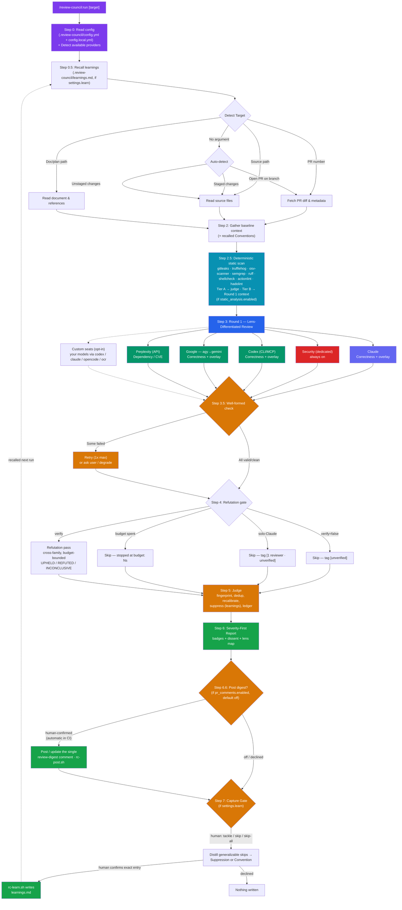
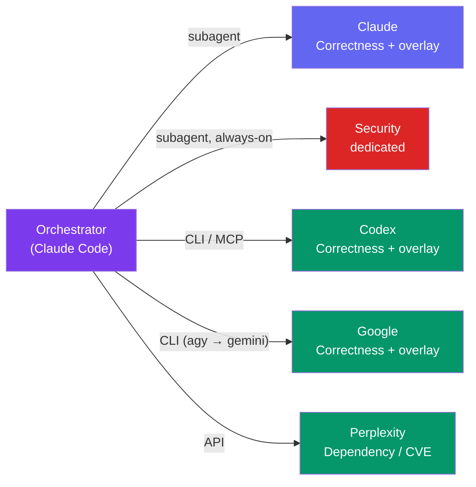
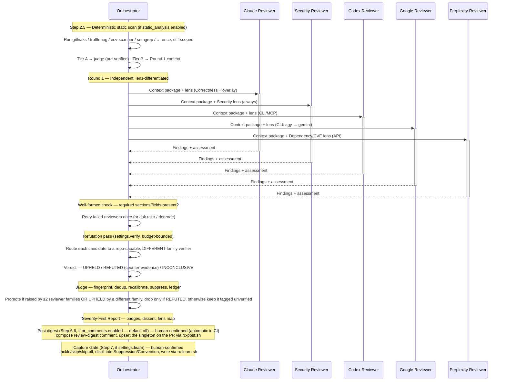
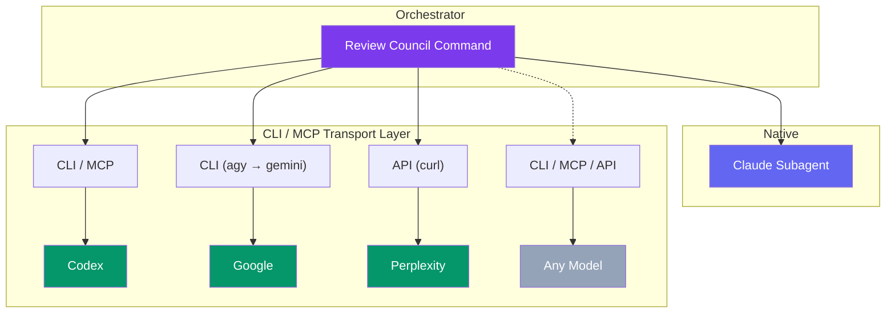

# Review Council

<!-- rc:description:start -->
Multi-agent code review for Claude Code. Multiple AI models review your PR, code, or plan independently; a cross-family refutation pass and an active judge then distill the findings into a curated, severity-ranked list of what actually needs changing.
<!-- rc:description:end -->

## Why

Single-model code review has blind spots. Different models catch different things. Review Council runs multiple reviewers in parallel, compares their findings, and produces a single curated report where:

- **Cross-reviewed findings** (raised by multiple reviewer families, or independently upheld by a different-family refutation pass) = high confidence, badged `[cross-reviewed]`
- **Single-reviewer findings** (one reviewer, not yet cross-verified) = worth considering, badged `[unverified]` or `[1 reviewer · unverified]` — never silently dropped for being unverified
- **Genuine disagreements** (a reviewer's counter-evidence refutes another's finding, or an unresolved conflict survives the judge) = documented as a dropped/refuted finding or a Dissenting Opinion, not just discarded
- **Learns from your triage** — a human-confirmed capture gate after each report distills your skip decisions into persisted false-positive suppressions & conventions in a committed `learnings.md`, recalled automatically on future runs

The result: fewer false positives, broader coverage, and a clear priority order. Review Council is orchestrated locally, inside a single Claude Code session, and by default only ever prints a report — it never pushes commits or posts to a PR on its own. Optionally (off by default) it can post a single review-digest comment to the PR after you confirm — see [Posting to PRs](#posting-to-prs). It can also [run unattended in GitHub Actions](#github-actions), where it posts the digest automatically. Note the data egress this implies: when Codex, Google, or Perplexity are enabled, the gathered review context (diff, file contents, etc.) is sent to those third-party tools/APIs — only Claude (the native subagent) stays fully local. An opt-in [custom reviewer seat](#custom-reviewer-seats) sends it to OpenRouter and the model's host (or nowhere, with a local Ollama model). Codex's own shell access during review is sandboxed read-only (`codex exec --sandbox read-only`) — it can read the repo but cannot write to it or reach the network.

## Quick Start

```bash
# Install the plugin
/plugin marketplace add deployhq/review-council
/plugin install review-council

# Check available providers
/review-council:setup

# Review something
/review-council:run              # auto-detect: current PR or staged changes
/review-council:run 42           # review PR #42
/review-council:run src/auth.ts  # review a source file
/review-council:run docs/plan.md # review a plan or document
```

## How It Works



**Auto-detection** means you usually just run `/review-council:run` with no arguments. It checks for an open PR on the current branch, then staged changes, then unstaged changes.

**Well-formed check (Step 3.5).** After Round 1, each reviewer's response is checked for required sections and fields (the finding schema: `severity`, `confidence`, `location`, `symbol`, `concern`, `issue`, `why_it_matters`, `recommendation`, `how_to_verify`, `source`) — a structural check, not a truth check. Malformed responses are retried once; if still failing, the orchestrator asks whether to proceed with the remaining reviewers or abort. Set `settings.auto_retry: true` (env: `RC_AUTO_RETRY=true`) to skip the prompt (useful in CI).

**Refutation pass (Step 4).** Gated on `settings.verify` (default on). Each candidate finding is routed to an isolated, different-family verifier — one that never sees the synthesis or any other reviewer's opinion, only the finding and the actual code — which returns **UPHELD** (positive supporting evidence), **REFUTED** (positive counter-evidence it's not a bug), or **INCONCLUSIVE** (can't decide; absence of proof is *never* REFUTED). Skipped in solo-Claude mode (for the native findings — a distinct [custom seat](#custom-reviewer-seats)'s findings are still refuted by a fresh Claude verifier), or once the run budget is spent — see [Verification & Badges](#verification--badges).

**Judge (Step 5).** A single active judge computes a canonical fingerprint per finding, deduplicates across models, and recalibrates severity/confidence: +1 tier when a finding was raised by ≥2 reviewer families *or* UPHELD by a different family, drop only when REFUTED with counter-evidence, keep-and-tag `[unverified]` when INCONCLUSIVE or unverified. A single-reviewer `critical` is never demoted for being unverified — it stays Critical, tagged `[1 reviewer · unverified]`. The judge also suppresses findings matching a learnings Suppression and emits a per-finding ledger before the prose report.

**Capture Gate (Step 7).** Gated on `settings.learn` (same knob as Step 0.5's recall) — off skips this step entirely. After the report, walks the surviving findings with you: mark each **tackle** (fixing it — nothing captured), **skip** (a one-line reason), or **skip all**. Only a skip with a *generalizable* reason becomes a learning — a scoped "known false positive here" becomes a **Suppression** keyed by the finding's ledger fingerprint, a general "we never flag X" becomes a **Convention**; a one-off "not now" captures nothing. Nothing is written until you explicitly confirm the exact entry text — then it's appended to `.review-council/learnings.md` via `scripts/rc-learn.sh`, which the next run's Step 0.5 recalls. Record-only: it never edits code, re-runs a reviewer, or changes the report just emitted.

## Reviewers



| Reviewer | Transport | Detection |
|----------|-----------|-----------|
| **Claude** | Native subagent | Always available |
| **Security** | Native subagent (dedicated) | Always available — runs regardless of which external providers are present |
| **Codex** (OpenAI) | CLI (`codex exec`) / MCP fallback | `which codex` or MCP tool |
| **Google** (Antigravity / Gemini) | CLI — `agy` preferred, `gemini` fallback | `which agy` or `which gemini` |
| **Perplexity** | Sonar API (`curl`) | `PERPLEXITY_API_KEY` env var |
| **Custom seats** (opt-in, your models) | `codex`, `claude` or `opencode` via `scripts/rc-seat.sh`; `ocr` via `scripts/rc-ocr.sh` | configured in `reviewers.custom` + the harness binary (+ the OpenRouter key var) — see [Custom reviewer seats](#custom-reviewer-seats) |

Minimum 2 reviewers needed for council mode (`settings.min_reviewers`, default 2). Claude and the dedicated Security reviewer are both native and always run, but they are the **same model family (Claude)** — council mode and the refutation pass need at least one reviewer from a **different family** (Codex, Google, or Perplexity) to cross-verify against. With only Claude-family reviewers (Claude + Security) available, the run proceeds in single-reviewer mode. Providers are auto-detected at runtime — no manual configuration needed.

**Lens-differentiated Round 1.** Every reviewer is assigned a lens before dispatch: the dedicated Security reviewer always carries the Security lens; every repo-capable frontier reviewer (Claude, Codex, Google) carries Correctness & concurrency as its core, plus one diff-aware specialist overlay chosen from what actually changed (Cross-file/API-contract, Performance & reliability, Design & maintainability, Data-integrity & migration, Config/workflow, or UI-state & accessibility); tool-less Perplexity always carries Dependency/CVE/best-practices. **Lens = emphasis, not blinders** — every reviewer still flags any critical issue it notices outside its lens. The chosen lens map is printed before Round 1 and again in the final report header. `.review-council/config.yml` can pin a lens to specific providers or disable it (see [Configuration](#configuration)); `settings.personas: false` reverts every reviewer to the identical legacy (non-lens) prompt.

**Google slot:** Antigravity (`agy`) and Gemini (`gemini`) run the same Gemini model family, so they share **one** reviewer slot. Whenever `agy` is installed it is the primary Google reviewer (labeled **Google (Antigravity)**) and `gemini` is only a last-resort fallback — never two Google votes. Google's consumer Gemini CLI "Sign in with Google" was [sunset on 2026-06-18](https://developers.googleblog.com/an-important-update-transitioning-gemini-cli-to-antigravity-cli/) in favor of the Antigravity CLI; Gemini CLI still works with a `GEMINI_API_KEY`, Vertex AI, or an enterprise Code Assist license.

Two behaviors keep the Google slot robust:

- **`agy` cold start.** `agy`'s first `-p` call in a session can take **several minutes** (model load + auth handshake + update check) versus ~10s once warm, and can occasionally exit `0` with no output. The council gives it real headroom — the per-reviewer cap `RC_REVIEWER_TIMEOUT` (10 min default) *and* agy's own `--print-timeout` are both sized to cover the cold start — and **retries `agy` once** on an empty result before doing anything else. So a slow or empty first call recovers on its own instead of losing the slot.
- **`gemini` is a dead end for Google Workspace accounts.** `gemini -p` fast-fails with `IneligibleTierError` (`DASHER_USER`, "not eligible for Gemini Code Assist for individuals") for any Workspace/managed (`@your-company`) account — install `agy` to use the Google slot on those. Because that fallback can never succeed on a Workspace account, the council no longer lets an `agy` hiccup silently fall through to a confusing "Gemini auth failure": Google-slot failures are reported attributed to the primary tool (`agy`), with the `gemini` ineligibility noted separately.

## Setup

### Prerequisites

- [Claude Code](https://claude.ai/code) CLI
- [GitHub CLI](https://cli.github.com/) (`gh`) — for PR reviews (optional)
- At least one additional reviewer for council mode:
  - [Codex CLI](https://github.com/openai/codex) — `npm install -g @openai/codex && codex login`
  - [Antigravity CLI](https://antigravity.google) (`agy`) — `curl -fsSL https://antigravity.google/cli/install.sh | bash` (preferred Google reviewer)
  - [Gemini CLI](https://github.com/google-gemini/gemini-cli) — `npm install -g @google/gemini-cli` (fallback; needs `GEMINI_API_KEY`, Vertex, or an enterprise Code Assist license — consumer "Sign in with Google" was sunset 2026-06-18)
  - [Perplexity API key](https://www.perplexity.ai/) — set `PERPLEXITY_API_KEY` env var

### Install

```bash
/plugin marketplace add deployhq/review-council
/plugin install review-council
```

Providers are auto-detected at runtime. Run `/review-council:setup` to check which providers are available.

### Optional dependencies

- **[yq](https://github.com/mikefarah/yq) (mikefarah v4)** — enables the optional config file (`.review-council/config.yml`). Run `/review-council:setup` and, with your consent, it will install `yq` for you; or install it yourself with `brew install yq` (macOS) or see the [yq install guide](https://github.com/mikefarah/yq#install). **Without `yq`, config files are ignored and the plugin runs on built-in defaults + `RC_*` env overrides** — still fully functional. (Heads-up: a *different* Python tool is also named `yq`; Review Council needs **mikefarah/yq**, whose `yq --version` prints a `github.com/mikefarah/yq` URL.)
- **[`ocr`](https://www.npmjs.com/package/@alibaba-group/open-code-review) + [`jq`](https://jqlang.org/)** — only for an opt-in [custom reviewer seat](#custom-reviewer-seats) on the `ocr` harness: `npm i -g @alibaba-group/open-code-review`. `/review-council:setup` reports both (print-only — it never installs them).
- **[bats](https://github.com/bats-core/bats-core) + yq** — only for running the unit-test suite (`bats tests/unit/`); not needed to use the plugin.
- **[Docker](https://www.docker.com/)** — optional, opt-in fallback for the static-analysis scan (Step 2.5): if a configured core scanner (`gitleaks`, `trufflehog`, `semgrep`, `osv-scanner`) isn't installed and Docker is running, the scan can run it from its official image instead — no local install needed. Set `RC_STATIC_DOCKER_TOOLS` (or confirm at the run-time prompt) to opt in; see [Static Analysis](#static-analysis-phase-2-step-25) → "Run a missing tool via Docker".

### Configuration

Review Council works with **zero configuration**. Optionally, add a `.review-council/config.yml` to the repo to control the reviewer roster, review lenses, and run settings; a gitignored `.review-council/config.local.yml` holds per-machine overrides. Precedence is applied **per key**: **env > config.local.yml > config.yml > built-in default**. `/review-council:setup` can scaffold both files, and the full schema (including the `reviewers:` and `lenses:` blocks) is documented in [`rules/config.md`](rules/config.md). Config files are parsed with `yq` (see Optional dependencies above); without it the plugin falls back to defaults + the environment variables below. Because a repo you review can commit its own `config.yml` — or even a `config.local.yml` — security-sensitive keys are honoured only from **trusted** places: an untracked `config.local.yml`, your environment, and (for [custom reviewer seats](#custom-reviewer-seats)) `~/.review-council/config.yml`.

Each run setting (`settings.*`) is also tunable via its `RC_*` environment variable (env wins over both config files); the full list is in [`rules/config.md`](rules/config.md). All of them:

| Variable | Default | Purpose |
|----------|---------|---------|
| `RC_PERSONAS` | `true` | Use reviewer lenses/personas when prompting reviewers; `false` reverts to the identical legacy (non-lens) prompt for every reviewer |
| `RC_VERIFY` | `true` | Run the refutation pass over candidate findings |
| `RC_VERIFY_CAP` | `12` | Cap on findings sent to the refutation pass (top by severity; the rest ship `[unverified]`) |
| `RC_LEARN` | `true` | Enable learnings recall (Step 0.5) and capture (Step 7) |
| `RC_MIN_REVIEWERS` | `2` | Minimum successful reviewers required for council mode |
| `RC_REVIEWER_TIMEOUT` | `600` | **Hard** per-invocation wall-clock cap (**seconds**, 10 min) for CLI/API reviewers; sized to cover `agy`'s multi-minute cold start (`agy`'s own `--print-timeout` is raised to match, as a unit-suffixed duration like `600s`/`10m`). Raise for very large diffs or slow networks. |
| `RC_RUN_BUDGET` | `600` | **Soft** total wall-clock budget (**seconds**) for the whole run — see "The two-cap model" below |
| `RC_AUTO_RETRY` | `false` | If `true`, retry failed reviewers without asking (CI-friendly) |
| `RC_HEALTH_PROBE` | `false` | Opt-in Step-0 health probe (Codex + Google slots) so `available`/`min_reviewers` reflect *usable*, not merely installed. Default off; a provider is dropped only on positive hard-fail evidence (auth/quota/overload), fail-open otherwise. |
| `RC_HEALTH_PROBE_TIMEOUT` | `20` | Short wall-clock cap (seconds) for each health probe |
| `RC_CLAUDE_MAX_TURNS` | `100` | Turn budget (`maxTurns`) for the native Claude and Security reviewer subagents. Default 100 (lenient); lower it to cap local review cost. |
| `RC_CI` | `false` | `true` = no human is present (set by the [GitHub Actions workflow](#github-actions)): never asks, posts the digest without a confirm step when posting is on, forces `auto_retry=true`, never writes `learnings.md` (recall still follows your `settings.learn`), and reads only PR comments and reviews from `OWNER`/`MEMBER`/`COLLABORATOR`. Env only. |
| `RC_APPROVED_SEATS` | — | Comma-separated custom-seat slot names approved to run without the start-of-run question (the workflow's `approved_seats` input). Env only. |
| `PERPLEXITY_API_KEY` | — | Enables Perplexity reviewer via Sonar API |

**The two-cap model.** Review Council bounds time with two independent caps, not one:

- **`reviewer_timeout_seconds` (hard, per-call).** Every individual CLI/API reviewer invocation is wrapped so it can never hang forever (`timeout`/`gtimeout`, or a pure-shell watchdog if neither is installed). A single stuck or overloaded provider fails in minutes, not tens of minutes.
- **`run_budget_seconds` (soft, whole run).** After each capped stage (Round 1, the refutation pass), the orchestrator sums the *measured elapsed* time those invocations actually took. If the budget is already spent, it **degrades rather than aborts** — skipping or shrinking the refutation pass, tagging the affected findings `[unverified]`, and printing `stopped at budget: <n>s` — then goes straight to the judge so a report is always produced.

### Learnings

Review Council reads and writes a repo's shared, checked-in `.review-council/learnings.md` so each run is informed by — and each run's triage feeds — past decisions. Gated end-to-end on `settings.learn` (`RC_LEARN`, default on): the same knob turns off both the read side (Step 0.5) and the write side (Step 7). The file has two sections:

- **Conventions** — project-specific rules about what not to flag (e.g. "Migrations are auto-generated; do not flag missing down-migrations"). Folded once into the shared Step-2 baseline context package, so every reviewer sees it.
- **Suppressions** — known false positives keyed by fingerprint (e.g. `src/adapters/*::*::unchecked-any | reason: intentional, see ADR-012`). Held for the judge (Step 5), which suppresses any surviving finding whose fingerprint matches and reports `Suppressions applied: N`.

If the file is absent, both are skipped silently on recall — a missing `learnings.md` is the normal case, not a warning.

**Capture (Step 7)** is the write side: after the report, a human-confirmed gate walks the surviving findings with you (tackle / skip / skip-all) and distills a skip with a *generalizable* reason into a new Suppression or Convention — never auto-applied, never written until you confirm the exact entry text. Approved entries are appended via `scripts/rc-learn.sh`, which creates the file (canonical §3.6 skeleton) if it's absent and is idempotent — re-confirming an existing entry is a safe no-op. See [`rules/config.md`](rules/config.md) → Learnings for the full format and lifecycle.

### Verification & Badges

When `settings.verify` is on and more than one reviewer family is available, Round 1 findings go through an isolated **refutation pass** (Step 4) before the judge: each candidate finding is routed to a repo-capable reviewer from a **different** family than the one that raised it (never to tool-less Perplexity), which returns one verdict — **UPHELD**, **REFUTED** (with positive counter-evidence), or **INCONCLUSIVE** — without ever seeing the synthesis or other reviewers' output. Absence of proof is always INCONCLUSIVE, never REFUTED.

The judge (Step 5) turns those verdicts into the badges shown in the final report:

| Badge | Meaning |
|---|---|
| `[verified]` | A Tier A static-analysis finding (pre-verified secret/CVE), or a Tier B finding an LLM reviewer corroborated on the same (judge-computed) fingerprint — see [Static Analysis](#static-analysis-phase-2-step-25) |
| `[cross-reviewed]` | Raised by ≥2 reviewer families, or UPHELD by a different-family verifier |
| `[1 reviewer · unverified]` | A single reviewer raised it and it wasn't (yet) cross-verified — critical findings are **never** demoted out of Critical for this |
| `[unverified]` | Not verified this run — over the `verify_max_findings` cap, or the run budget was spent before verification (solo-Claude findings get `[1 reviewer · unverified]` instead) |
| `[tool-only:<rule>]` | A Tier B static-analysis signal no reviewer corroborated on the same fingerprint — stays a low-severity Suggestion, never Critical/Important on tool say-so alone — see [Static Analysis](#static-analysis-phase-2-step-25) |

Badge precedence when more than one could apply: `[verified]` > `[cross-reviewed]` > `[1 reviewer · unverified]` > `[unverified]` > `[tool-only:<rule>]` — the strongest badge is shown; others are noted in prose where relevant.

### Static Analysis (Phase 2, Step 2.5)

Between gathering context (Step 2) and Round 1, Review Council can run a deterministic static-analysis layer — grounded evidence for the council, not a second vote. Gated on `static_analysis.enabled` (default on); when it runs, one subagent probes up to eight external tools and diff-scopes each one that's present and applicable:

| Tool | Tier | Catches | Install |
|---|---|---|---|
| [`gitleaks`](https://github.com/gitleaks/gitleaks) | A — secrets | Hardcoded secrets (regex/entropy rules) | `brew install gitleaks` |
| [`trufflehog`](https://github.com/trufflesecurity/trufflehog) | A — secrets, live-verified | Secrets, confirmed live against the provider | `brew install trufflehog` (or the official install script) |
| [`osv-scanner`](https://github.com/google/osv-scanner) | A — known CVEs | Known-vulnerable dependencies in lockfiles | `brew install osv-scanner` |
| [`semgrep`](https://semgrep.dev/) | B — SAST | Broad static-analysis rule coverage | `brew install semgrep` (or `pipx install semgrep`) |
| [`ruff`](https://github.com/astral-sh/ruff) | B — Python lint | Python lint/style issues | `brew install ruff` (or `pipx install ruff` / `uvx ruff`) |
| [`shellcheck`](https://www.shellcheck.net/) | B — shell lint | Shell-script bugs and pitfalls | `brew install shellcheck` |
| [`actionlint`](https://github.com/rhysd/actionlint) | B — CI lint | GitHub Actions workflow errors | `brew install actionlint` |
| [`hadolint`](https://github.com/hadolint/hadolint) | B — Dockerfile lint | Dockerfile best-practice violations | `brew install hadolint` |

**The two-tier model:**

- **Tier A — verified / high-precision.** Secrets and known-CVE hits go straight into the report, pre-verified, badged `[verified]`, exempt from the suggestion cap, and never downgraded by the judge — severity is *inherited* from the tool, not judge-assigned. (`gitleaks` is precision-by-rule — regex/entropy — not live-verified the way `trufflehog` is; still high-precision, just a different guarantee.)
- **Tier B — SAST/lint, context not a verdict.** Findings are folded into Round 1's shared context under "PRE-EXISTING STATIC-ANALYSIS SIGNALS — corroborate or dismiss." Every reviewer sees them; a reviewer match on the same (judge-computed) fingerprint promotes the finding to `[verified]`, while a tool-only hit survives only as a capped `suggestion` badged `[tool-only:<rule>]` — never Critical/Important on tool say-so alone.

Static analysis is never a voting reviewer: no lens, doesn't count toward `min_reviewers`, never routed through the refutation pass. Only repo-owned tool configuration is ever used (`.gitleaks.toml`, `.semgrep.yml`, etc., already committed to the target repo) — a PR-supplied tool config or ruleset is never fetched or executed, the direct lesson from the CodeRabbit-config-RCE precedent this project deliberately avoids repeating.

**Config keys** (`.review-council/config.yml`, precedence `env > config.local.yml > config.yml > default` — full schema in [`rules/config.md`](rules/config.md)):

| Key | Default | Env override | Purpose |
|---|---|---|---|
| `static_analysis.enabled` | `true` | `RC_STATIC_ANALYSIS` | Turn the whole Step 2.5 scan on/off |
| `static_analysis.tools` | all 8 (`gitleaks, trufflehog, osv-scanner, semgrep, ruff, shellcheck, actionlint, hadolint`) | `RC_STATIC_TOOLS` | Which tools to run (comma-separated); unknown names are dropped with a note |
| `static_analysis.timeout_seconds` | `60` | `RC_STATIC_TIMEOUT` | Per-tool hard timeout (same watchdog machinery as the reviewer timeout) |
| `static_analysis.semgrep_config` | `p/default` | `RC_SEMGREP_CONFIG` | A registry pack (`p/default`, `p/ruby`, …), `off`, or a repo-owned ruleset path (`auto` is skipped — it needs metrics we disable) |

**Setup.** `/review-council:setup` probes all eight tools (grouped Tier A / Tier B) and, for anything missing, prints its install command — **print-only**: unlike the `yq` flow, `setup` never installs a static-analysis tool itself, even with consent. Install whichever you want; Review Council picks them up automatically on the next run (`command -v` probe, no restart needed).

**Run a missing tool via Docker (no install).** When a configured tool is missing and Docker is running, the Step-2.5 gate offers to run it from its official image for that run — the four core scanners (`gitleaks`, `trufflehog`, `semgrep`, `osv-scanner`) only. It's opt-in per-run via `RC_STATIC_DOCKER_TOOLS` (nothing changes unless you set it or confirm at the prompt), a natively-installed tool always takes precedence, and the finding is indistinguishable from a native one. First use pulls the image (one-time, a few hundred MB); images are `:latest`; `trufflehog`'s verified-mode egress is unchanged.

**`trufflehog` outbound-network caveat.** `trufflehog`'s `--results=verified` mode makes **live outbound network calls**, authenticating with each found credential against its actual provider (e.g. confirming an AWS key is real by calling AWS with it). That's what makes its hits verified/high-precision, but it means a "local, report-only" tool reaches out to third-party services, and the verification call itself could trip the *credential owner's* own anomaly detection. `trufflehog` is **default-on**; the one-line opt-out is dropping it from `static_analysis.tools` (or `RC_STATIC_TOOLS`). If the network is unreachable, the scan degrades gracefully (treated as "ran, 0 findings") rather than erroring the run.

**Missing a configured tool.** A tool absent from your machine but present in `static_analysis.tools` isn't silently skipped — the review pauses and asks: it tells you which tool(s) are missing and how to install each, then asks whether to install now and re-run the scan, or proceed without them for this run. Proceeding is always an option; nothing blocks the run outright. Tools that aren't relevant to the diff (e.g. `ruff` when no `*.py` changed) are skipped quietly — there's nothing to install for those.

### Uninstall

```bash
/review-council:uninstall    # Prompts to remove Codex MCP server entry from ~/.claude/settings.json
/plugin uninstall review-council
```

## Output Example

```
## Review Council Report

**Target:** PR #42 — "Add rate limiting to API endpoints"
**Type:** PR
**Reviewers:** Claude, Security, Codex, Antigravity (4 of 5 — Perplexity: PERPLEXITY_API_KEY not set)
**Lens map:** Security: Security (dedicated) · Claude: Correctness + Data-integrity & migration · Codex: Correctness + Cross-file / API-contract · Antigravity: Correctness + Performance & reliability
**Pipeline:** static scan → Round 1 → well-formed check → refutation → judge → report
Static analysis: gitleaks (ok, 0), trufflehog (ok, 1 verified secret), osv-scanner (ok, 0), semgrep (ok, 3 signals), ruff (skipped: no *.py in diff), shellcheck (skipped: not installed — proceeding), actionlint (skipped: no workflow changes), hadolint (skipped: no Dockerfile changes)

Judge ledger:
fingerprint                                       | origin-families    | verdict      | suppression? | tool?      | final-severity | final-confidence
config/redis.yml::_::hardcoded-aws-key            | —                   | TOOL-VERIFIED| no           | trufflehog | critical       | high
rate-limit.ts::ratelimiter::in-memory-store       | codex,claude        | UPHELD       | no           | —          | critical       | high
rate-limit.ts::ratelimiter::ip-only-key           | claude              | INCONCLUSIVE | no           | —          | important      | high
api.ts::handler::missing-rate-limit-headers       | codex,antigravity   | UPHELD       | no           | —          | important      | medium
rate-limit.ts::ratelimiter::empty-catch-swallows  | —                   | TOOL-ONLY    | no           | semgrep    | suggestion     | medium
Suppressions applied: 0

### Critical Issues

1. **[critical] [high]** `[verified]` — `config/redis.yml:12`
   - Issue: Hardcoded AWS access key, confirmed live by trufflehog's verified scan
   - Why: A committed, working credential grants an attacker direct account access
   - Fix: Revoke the key immediately, rotate credentials, and load secrets from the environment or a secret manager instead

2. **[critical] [high]** `[cross-reviewed]` — `src/middleware/rate-limit.ts:28`
   - Issue: Rate limit counter uses in-memory store — resets on every deploy
   - Why: Users get full quota back on each deployment, defeating the purpose
   - Fix: Use Redis or PostgreSQL for counter storage

### Important Findings

3. **[important] [high]** `[1 reviewer · unverified]` — `src/middleware/rate-limit.ts:15`
   - Issue: Rate limit key uses IP only — shared IPs (corporate NAT) throttle all users
   - Why: Enterprise customers behind NAT will hit limits quickly
   - Fix: Use authenticated user ID as primary key, fall back to IP for anonymous

4. **[important] [medium]** `[cross-reviewed]` — `src/routes/api.ts:44`
   - Issue: Rate limit headers (X-RateLimit-Remaining) not included in responses
   - Why: Clients can't implement backoff without knowing their remaining quota
   - Fix: Add standard rate limit headers per RFC 6585

### Suggestions

5. **[suggestion] [medium]** `[tool-only:semgrep:javascript.lang.best-practice.no-empty-catch]` — `src/middleware/rate-limit.ts:52`
   - Issue: Empty catch block silently swallows errors from the counter increment
   - Why: Failures in the rate-limit check disappear without a trace, masking real bugs
   - Fix: Log the caught error (or handle it explicitly) instead of an empty catch

6. **[suggestion] [medium]** `[unverified]` — `docs/api.md`
   - Issue: No documentation of rate limit behavior for API consumers
   - Fix: Add rate limits section to API docs

### What's Done Well
- Clean middleware pattern — easy to adjust limits per route
- Good test coverage for the happy path
```

Severity is the primary sort (Critical / Important / Suggestions); agreement is a badge, not the sort key — a well-substantiated single-reviewer Critical still leads the report, just tagged `[1 reviewer · unverified]`. A per-finding **ledger** (`fingerprint | origin-families | verdict | suppression? | tool? | final-severity | final-confidence`) and a `Suppressions applied: N` line are emitted by the judge just before this prose report. A **Dissenting Opinions** section appears only when disagreement is genuinely unresolved after the judge; it's omitted here because there was none.

## Architecture

### Plugin Structure

```
review-council/
├── .claude-plugin/
│   ├── plugin.json          # Plugin metadata
│   └── marketplace.json     # Marketplace listing
├── .github/workflows/
│   ├── review-council.yml   # Reusable workflow: run the council on PRs in GitHub Actions
│   └── unit-tests.yml       # bats unit tests
├── docs/
│   └── github-action.md     # GitHub Actions guide
├── examples/
│   └── github-action/       # Copy-paste caller workflow + example config.yml for CI
├── skills/
│   ├── run/SKILL.md         # Main command (orchestrator)
│   ├── setup/SKILL.md       # Provider status checker
│   └── uninstall/SKILL.md   # Cleanup
├── agents/
│   ├── reviewer-claude.md   # Claude reviewer persona
│   └── reviewer-security.md # Dedicated security reviewer persona (always-on)
├── rules/
│   ├── orchestration.md     # Round 1, well-formed check, budget, severity/recalibration rules
│   ├── delegation-format.md # External model prompt format + refutation template
│   ├── providers.md         # Provider registry
│   ├── config.md            # Config schema (reviewers, lenses, settings, static_analysis)
│   └── static-analysis.md   # Static-analysis tool registry, tiers, noise-control (Phase 2)
├── scripts/
│   ├── rc-invoke-provider.sh  # Shared provider-dispatch state machine (Codex + Google)
│   ├── rc-config.sh           # Config reader (files + env + defaults)
│   ├── rc-static-scan.sh      # Static-analysis runner (Phase 2)
│   ├── rc-learn.sh            # learnings.md writer — Step 7 capture (Phase 3)
│   ├── rc-post.sh             # PR review-digest posting engine — Step 6.6 (v0.10.0)
│   ├── rc-ocr.sh              # Custom reviewer seat dispatch: isolated ocr run + JSON → §3.1 mapper
│   ├── rc-lib-family.sh       # Model slug → family map (shared by rc-config.sh and rc-ocr.sh)
│   ├── rc-lib-timeout.sh      # Shared timeout/watchdog helper
│   └── sync-metadata.sh       # Propagates plugin.json's description to README/CLAUDE.md/marketplace.json
├── tests/
│   ├── unit/                # bats unit tests for the scripts
│   └── fixtures/            # Tier-2 artifact-shape fixtures (local/on-demand, never CI)
├── CLAUDE.md                # Plugin instructions
├── LICENSE                  # MIT
└── README.md                # This file
```

### Round 1 → Refutation → Judge



### Design Decisions

**Why parallel independent reviews?** If reviewers see each other's output, they anchor on the first response. Independent review ensures genuinely different perspectives.

**Why a structured delegation format?** Different models have different defaults. The delegation format (TASK, REVIEW PROCESS, CONTEXT, EXPECTED OUTCOME, CONSTRAINTS, MUST DO, MUST NOT DO, OUTPUT FORMAT) forces consistent, comparable output regardless of the model. See `rules/delegation-format.md` for the full template.

**Why refutation instead of a revision round?** An earlier design shared the Round 1 synthesis and asked every reviewer to revise (a "Round 2"). That re-introduces anchoring — models converge toward whichever finding was phrased first instead of independently checking it. Refutation instead routes each candidate finding to an isolated, different-family verifier that never sees the synthesis or any other reviewer's opinion — only the finding and the actual code — and returns UPHELD / REFUTED / INCONCLUSIVE. Absence of proof is always INCONCLUSIVE, never REFUTED, so an unresolved finding is never silently dropped.

**Why an active judge instead of a vote?** A single judge computes the canonical fingerprint per finding, deduplicates across models, and recalibrates severity/confidence from the refutation verdicts. Genuinely unresolved disagreement becomes a "Dissenting Opinions" report section — not another round of debate.

**Why two budget caps?** `reviewer_timeout_seconds` bounds each individual CLI/API call so one stuck provider can't hang the run. `run_budget_seconds` bounds the whole run and degrades gracefully — shrinking or skipping the refutation pass rather than aborting — once the measured elapsed time adds up (e.g. a slow `agy` cold start plus several reviewers).

**Why filter aggressively?** The biggest failure mode of AI code review is noise — too many low-value findings. Review Council filters: confidence from cross-family verification (not just raw agreement), severity-first ordering, and explicit rules against style nitpicks.

## Posting to PRs

By default Review Council is **report-only**. You can opt in to have it post a single **review-digest comment** to the pull request — a summary of the AI's run, not an inline line-by-line review. The comment has three sections: **what was found (and by whom)**, **what the council decided**, and **what was fixed** (your triage). Re-running updates the *same* comment in place, so there is no spam.

Turn it on in `.review-council/config.yml` (or `config.local.yml`):

```yaml
pr_comments:
  enabled: true                  # default false
  bot_token_env: RC_PR_BOT_TOKEN # optional; see "Identity" below
```

**Locally, it never posts on its own.** After the report you triage each finding (fix / defer / won't-fix), review the composed digest, and explicitly confirm before anything is posted. If the branch has no open PR, it offers to open a **draft** so the digest has a home. Nothing is posted if you decline.

**In CI it posts automatically.** The one exception is an unattended run (`RC_CI=true`, set by the [GitHub Actions workflow](#github-actions)): with posting enabled, it posts without asking, skips the triage walk (the "what was fixed" section reads `Not triaged — automated CI run.`), and never opens a draft PR.

**State block and footer.** The comment starts with a hidden `<!-- rc:state {...} -->` line (the reviewed commit SHA, `clean` / `findings` / `degraded`, and counts per severity) that tools and agents can parse, and ends with a footer: `Review done with Review Council · <who posted>`. Likely secrets in the body are replaced with `[REDACTED]` before posting. Details: [docs/github-action.md](docs/github-action.md#the-digest-comment).

**Identity.** With no token configured, the comment posts under **your own authenticated `gh` account**; the footer marks it as automated (`posted by @you (not a personal comment)`). In GitHub Actions it posts as `github-actions[bot]`, or as your own App or bot via the workflow's `PR_BOT_TOKEN` secret. If a bot token's login can't be read, the footer drops the identity. To post under a distinct identity instead, put a token in the env var named by `bot_token_env` (default `RC_PR_BOT_TOKEN`) — a bot account's fine-grained PAT or a GitHub App installation token; the comment posts as that bot. The token only ever comes from your environment, never from committed config, and the target PR is always taken from your local git — a repo you review can't redirect where comments land.

This reverses the report-only posture behind an explicit opt-in; the digest (findings + your decisions) is sent to GitHub when you post.

## Custom reviewer seats

Bring your own models — Qwen, Kimi, GLM, DeepSeek, or a local Ollama model — as extra Round-1 reviewers, with no plugin change. Each seat borrows an agentic CLI as its **harness**, which supplies the read-only tool loop; the **model** is the reviewer. Pick one per seat:

| `harness` | What it is | Read-only boundary | Notes |
|---|---|---|---|
| `codex` | OpenAI's Codex CLI (`npm i -g @openai/codex`), no OpenAI account needed | the OS kernel sandbox (writes); reads are **not** confined | Gets the council's prompt and a lens. With OpenRouter, anything on your machine it reads can leave it — its own key included — and it can't send `data_collection: deny`. Prefer `claude` for OpenRouter, or use a [dedicated key](#custom-reviewer-seats). |
| `claude` | Claude Code (already installed — it's the host) | only `Read`/`Grep`/`Glob` exist, confined to a snapshot of the repo | **The default for OpenRouter.** Gets the council's prompt and a lens; real turn limit (`max_turns`). |
| `opencode` | opencode (`npm i -g opencode-ai`) | council-written deny-all config | Version 1.19.0 or newer (guards re-tested on 1.19.3). |
| `ocr` | Alibaba's OpenCodeReview (`npm i -g @alibaba-group/open-code-review`, plus `jq`) | fixed read-only tool set | Its own whole-diff review pipeline with a coverage line; no lens; slow. |

**More harness examples** (every harness takes `provider: ollama` or `openrouter`):

```yaml
reviewers:
  custom:
    kimi-claude:                        # Kimi on OpenRouter through Claude Code
      harness: claude
      provider: openrouter
      model: moonshotai/kimi-k2.7-code
      role: reviewer
      harness_options:
        max_turns: 40                   # default: settings.claude_max_turns
    qwen-codex:                         # a local model through codex
      harness: codex
      provider: ollama
      model: qwen3.6:35b-a3b-coding-nvfp4
    glm-opencode:                       # GLM through opencode
      harness: opencode
      provider: openrouter
      model: z-ai/glm-5
      harness_options:
        timeout_minutes: 15             # default: 30 min for Ollama seats, settings.reviewer_timeout_seconds otherwise
```

Several seats can run in one review. Two seats on the same vendor (two Kimi seats) count as **one** family, and seats never confirm each other's findings — that takes a native reviewer. A repo's committed config can add at most **one** seat per review. Every agent seat reviews a snapshot of the repo's **tracked** files (never `.env` or other untracked files), and an Ollama model must already be pulled.

The `ocr` examples: **Opt-in and off by default** — no seat exists until you configure one, and no model is ever chosen for you.

Put it in your **user layer**, `~/.review-council/config.yml` (trusted, applies to every repo you review — or an *untracked* `.review-council/config.local.yml` for one repo):

```yaml
reviewers:
  custom:
    qwen-local:                         # a local model: nothing leaves your machine
      harness: ocr
      provider: ollama
      model: qwen3.6:35b-a3b-coding-nvfp4
      role: signal                      # default
```

```yaml
reviewers:
  custom:
    kimi:                               # an OpenRouter model, billed to your key
      harness: ocr
      provider: openrouter
      model: moonshotai/kimi-k2.7-code
      role: reviewer
      api_key_env: OPENROUTER_API_KEY   # the NAME of the env var holding the key (this is the default)
      harness_options:
        effort: medium                  # low (default) | medium | high — ocr's review rounds
        timeout_minutes: 30             # default: 20 for Ollama, else derived from settings.run_budget_seconds
        concurrency: 4
        max_tokens_budget: 2000000
        flags: ["--max-tools", "80"]    # extra ocr flags — trusted files only
        env: { OCR_LLM_TIMEOUT: "600" } # extra ocr env — trusted files only
```

Every configured seat whose harness is installed runs; seats from your own files (user file, untracked `config.local.yml`) are listed before a repo's committed seats. `flags` and `env` exist only for `ocr`. Full schema, guards and defaults: [`rules/config.md`](rules/config.md) → `reviewers.custom`.

**`role`** decides how the council treats the seat:

- **`signal`** (default) — its findings appear in a separate **"Extra signals (<slot> via <harness>)"** section of the report. It never counts toward `min_reviewers`.
- **`reviewer`** — its findings are merged into the main list. It counts toward `min_reviewers` only when its model is a **distinct** family and its run completed (for `ocr`: covered the whole diff); a partial or skipped run demotes it to `signal` for that review.

Either way the seat is a **finder only**: it never verifies (or refutes) anyone else's finding, and never lifts solo-Claude mode for the native reviewers. Its family comes from the model slug: `Qwen`, `Moonshot` (Kimi), `Zhipu` (GLM) and `DeepSeek` are **distinct** — their findings go through the refutation pass and can corroborate another family's. A Claude, GPT or Gemini model, or anything the map doesn't know, is allowed but **non-distinct**: its findings stay `[unverified]` and never count as a second family.

**`harness_options`** — `effort`, `concurrency`, `max_tokens_budget` and `timeout_minutes` are validated and accepted from any config file. `flags` and `env` are free-form, so they are honoured only from trusted files (your user layer or an untracked `config.local.yml`); flags that would undo the seat's isolation (`--rule`, `--provider`, `--model`, `--from`/`--to`, `-o`, …) are never accepted.

**Egress.**

| `provider` | Where review context goes |
|---|---|
| `openrouter` | OpenRouter and the host serving the model. `data_collection: deny` is hard-coded on every request — it is not configurable and never read from any config. It governs training on your data, not where the code goes. |
| `ollama` | Nowhere — `127.0.0.1:11434` only. |

Endpoints are fixed in code (there is no URL key), the key value is read from your environment and never written anywhere, and each run uses a throwaway `HOME`, so your own `~/.opencodereview/` is never read or changed. The reviewed repo's own `ocr` rules are displaced by a neutral council rule file, checked before every run.

**The human gate.** If a repo you review switches on a seat **only** through its committed `config.yml`, and that seat would send code to OpenRouter on your key, the review asks you once at the start and skips the seat unless you say yes. A committed `config.yml` can never set `api_key_env`, `flags` or `env`. (A `config.local.yml` that git tracks counts as committed.)

**Use a dedicated OpenRouter key.** A `codex` seat runs shell commands, and codex holds the key in its own environment, so a repo with planted instructions can get the model to read it. The seat's answer is thrown away (`SKIPPED: … answer contained the provider key`) if it contains the key — plain, spaced out, reversed or base64 — but a determined injection can still encode it some other way, and the model host sees whatever the tools read. So give review-council its own key, not your main one: in OpenRouter's key settings set a **credit limit** (with a daily or weekly reset) and an **expiry**, and attach a **guardrail** that allows only the models you use and requires Zero Data Retention. Then point seats at it, e.g. `api_key_env: OPENROUTER_REVIEW_KEY`.

**The coverage line.** `ocr` reviews the diff itself, and at the default budget it often runs out of time before every file is done. So whenever the seat ran — complete, partial, or with zero findings — the report prints what it actually covered, under the Pipeline line (and in the PR digest):

```
ocr · qwen (qwen/qwen3.8-max-0902): reviewed 14/23 selected files · 9 failed: provider (9)
      · 20 of 43 changed files excluded before review · 1 comment dropped (path not reviewed) · 0 warnings
```

A file the seat did not review is not a file the council calls clean. For fuller coverage, set the seat's `timeout_minutes` to give only that seat more time, or — for an OpenRouter seat — raise `settings.run_budget_seconds` (the seat gets ⅔ of it, up to 180 minutes). An Ollama seat defaults to 30 minutes, multiplied by `ocr`'s rounds (`effort` medium ×2, high ×3). The seat runs on its own clock: a slow seat makes the run longer, but never skips the double-check (refutation) of the other reviewers' findings.

**Choosing a model (non-normative).** From our spikes on one 43-file diff:

- **Qwen3.8-Max via OpenRouter** — the best precision, and the only model to find a new real bug; slow (one host, about 30 tok/s): 5/23 files in 16–26 min, 14/23 after 2 h 43 min; about $9.70 for three runs.
- **`qwen3.6:35b-a3b` MoE on local Ollama** (M5 Pro, 48 GB) — fast, free, and the code never leaves the machine: 23/23 files in 51 min. Weak: about 1 partly-valid comment in 9.
- **As a `codex` seat on local Ollama** (a 379 KB, 42-file PR prompt): the `qwen3.6:35b-a3b` MoE returned a full review in about 8 minutes; the dense `qwen3.8:27b` timed out at the 20-minute cap (the default then) without one; on a 631 KB prompt (~174k tokens) it took 21 minutes just to read the prompt. For local seats, prefer the MoE.
- **Kimi K2.7-code via OpenRouter** — untested; more hosts, about $4 a run estimated, and a distinct family.

None met our go bar (full coverage in under ~10 min for under ~$2, with a verified new finding). Treat the seat's output as leads for the council to check — that is what `role: signal` is for.

## GitHub Actions

Run the council on your PRs with no human in the loop. You call a **reusable workflow** from your repo; it runs headless Claude Code with the plugin loaded and posts one review-digest comment on the PR as `github-actions[bot]` (or your own bot).

- **When:** a PR is marked ready for review, or someone with write access comments `/review-council`. Drafts and PRs from forks are ignored.
- **Secrets:** `ANTHROPIC_API_KEY` (required); `OPENAI_API_KEY` for Codex, `PERPLEXITY_API_KEY`, `OPENROUTER_API_KEY` for custom seats, `PR_BOT_TOKEN` to post as your own App or bot (optional).
- **Config:** the committed `.review-council/config.yml` (and `learnings.md`) from the PR's branch, with workflow env on top. Custom seats run only when the workflow approves them by slot name (`approved_seats`); the PR's config still defines the seat.
- **Trust:** the boundary is write access. Fork PRs are skipped, and only comments and reviews from owners, members and collaborators are read. The orchestrator holds your keys, so use dedicated, spend-limited ones.
- **Advisory:** the digest never blocks a merge. A hidden state block (`clean` / `findings` / `degraded`) lets an agent or a gate read the result.
- **Cost:** about 3.5 minutes and $3 Claude-side on a tiny diff in our test; real PRs cost more.

```yaml
# Trimmed: the full example also sets the triggers and the required permissions.
jobs:
  review:
    # Pin @main and plugin_ref to the same release tag or commit SHA.
    uses: deployhq/review-council/.github/workflows/review-council.yml@main
    with:
      plugin_ref: main
    secrets:
      ANTHROPIC_API_KEY: ${{ secrets.ANTHROPIC_API_KEY }}
      OPENAI_API_KEY: ${{ secrets.OPENAI_API_KEY }}
```

Setup, inputs, the digest format and the security model: **[docs/github-action.md](docs/github-action.md)**. Copy-paste files: [`examples/github-action/`](examples/github-action/).

## Adding New Reviewers (Extensibility)

The architecture supports any model accessible via CLI or API. **To add a model without changing the plugin**, configure a [custom reviewer seat](#custom-reviewer-seats) instead — the rest of this section is about adding a new built-in provider.



Adding a new reviewer requires adding an entry to `rules/providers.md` with detection, CLI invocation, MCP fallback, and env requirements. Then update `skills/run/SKILL.md` to include it in the parallel dispatch and give it a lens in the Lens Assignment step (a specialist overlay, or a fixed lens if it's tool-less like Perplexity), plus an entry in the `reviewers:` block of `rules/config.md` so it can be enabled/disabled/pinned per repo.

The delegation format in `rules/delegation-format.md` ensures consistent, comparable output across all providers — including the §3.1 finding schema and the refutation template used in the verification pass. Transport is CLI-primary with MCP fallback — see the provider registry for details.

## Contributing

1. Fork the repo
2. Create a feature branch
3. Test with `/review-council:run` on real PRs/code
4. Submit a PR

## License

MIT - see [LICENSE](LICENSE).
